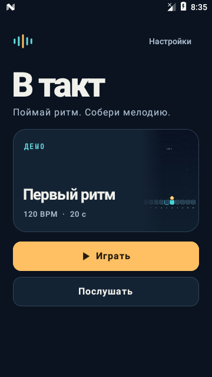

# В такт

Офлайн-ритм-игра для iPhone и Android на Kotlin Multiplatform и Compose Multiplatform. Следи за шариком и нажимай, когда он касается следующей площадки. Успешное касание играет ноту выбранным инструментом. Если пропустить удар, шарик продолжит путь в тишине.

**В версии 0.2** можно выбрать одну из восьми коротких одноголосных аранжировок. «Послушать» исполняет её автоматически, «Играть» передаёт ноты игроку. В спокойном темпе между ударами минимум 740 мс. Тембры фортепиано, маримбы и синтезатора доступны во всех треках.

<p>
  
  
</p>

[Посмотреть прыжки под Gypsy Woman на маримбе, 9 секунд со звуком](docs/preview/gypsy-woman.mp4). Демо отрисовано покадрово по траектории игры.

## Первый запуск на Mac

1. Понадобятся полный **Xcode 26.0.x**, компонент iOS Simulator и **JDK 17**. Эталонная конфигурация проекта — Xcode 26.0.1 и macOS 15.6 или новее с поддержкой этой версии Xcode. Установи JDK, например Temurin 17 для архитектуры своего Mac. Открой Xcode хотя бы один раз, прими лицензию и заверши установку компонентов. Kotlin, Gradle и зависимости скачиваются при первой сборке.
2. Клонируй репозиторий и перейди в корень `pinch-music`, где лежит `gradlew`. Если в системе несколько Xcode, выбери нужный в **Xcode → Settings → Locations → Command Line Tools**. Проверь окружение и открой проект.

   ```bash
   xcodebuild -version
   /usr/libexec/java_home -F -v 17
   chmod +x gradlew
   open iosApp/iosApp.xcodeproj
   ```

3. Выбери схему **iosApp** и установленный **симулятор iPhone** в верхней панели Xcode. Нажми **⌘R**. Первый запуск собирает `ComposeApp.framework` через Gradle, затем запускает игру в симуляторе. Apple ID и подпись для этого шага не нужны.
4. На настоящем iPhone добавь Apple ID в Xcode, подключи телефон, подтверди доверие, при необходимости включи Developer Mode. У цели **iosApp → Signing & Capabilities** выбери **Team**, включи автоматическую подпись и укажи свой уникальный Bundle Identifier, если текущий занят. Выбери iPhone вместо симулятора и нажми **⌘R**. Ритм и задержку звука лучше оценивать на самом телефоне.

Команда для проверки сборки без открытия Xcode на Apple Silicon:

```bash
xcodebuild -project iosApp/iosApp.xcodeproj -scheme iosApp \
  -configuration Debug -destination 'generic/platform=iOS Simulator' \
  ARCHS=arm64 ONLY_ACTIVE_ARCH=YES CODE_SIGNING_ALLOWED=NO build
```

Для поддерживаемого Intel Mac используй `ARCHS=x86_64`. Если Xcode пишет, что Java не найдена, проверь именно `/usr/libexec/java_home -F -v 17` — эта команда должна найти установленный JDK 17. При использовании Homebrew установить его можно через `brew install --cask temurin@17`. Сборка использует JDK 17, даже если в системе по умолчанию выбрана Java 25. Если список симуляторов пуст, установи iOS Simulator в настройках компонентов Xcode. Устанавливать CocoaPods или генерировать проект перед запуском не требуется.

## Android с Mac или Linux

Установи JDK 17, Android SDK Platform 36, Build-Tools 35.0.0 и Platform-Tools. В Android Studio можно открыть корневую папку, выбрать конфигурацию приложения модуля `composeApp`, затем реальное устройство или эмулятор API 24+. В терминале на Mac со стандартным расположением Android SDK выполни команды ниже.

```bash
export JAVA_HOME="$(/usr/libexec/java_home -F -v 17)"
export ANDROID_HOME="$HOME/Library/Android/sdk"
./gradlew :composeApp:testDebugUnitTest :composeApp:assembleDebug
./gradlew :composeApp:installDebug
```

Для `installDebug` заранее запусти эмулятор или подключи телефон с включённой USB-отладкой. APK появляется в `composeApp/build/outputs/apk/debug/`.

## Каталог и собственная запись

В каталог входят On the Floor, Stereo Love, Gypsy Woman, Levels, Stay (The Kid LAROI & Justin Bieber), Turn Down for What, Yeah! и The Final Countdown. Каждая карточка содержит короткую игровую фразу. У Gypsy Woman акцент на органной гармонии. Исходные коммерческие записи для игры не требуются.

Чтобы получить фразу из своей записи, выбери песню и нажми **«Выбрать свою запись»**. Выбери аудиофайл из системного диалога. Приложение локально декодирует до 30 секунд аудио, ищет устойчивые высоты ведущего голоса и атаки, убирает близкие удары и сохраняет ноты для этой карточки. На длинной записи участок выбирается автоматически. Короткий файл с нужным припевом даёт контроль над фрагментом. Чистая вокальная или инструментальная дорожка даст более точный результат, чем насыщенный микс. Через **«Вернуть встроенную»** можно восстановить авторскую игровую фразу.

Приложение сохраняет на устройстве выбранную мелодию, инструмент и режим. У каждого трека, темпа и локальной аранжировки свой рекорд.

## Организация проекта

| Код | Назначение |
| --- | --- |
| `composeApp/src/commonMain/kotlin/music/pinch/ui/MarblePath.kt`, `MarbleStage.kt` | Траектория и геометрия в трёх координатах, перспективная камера, проекция, освещение и тени. Начало ноты задаёт точный момент касания. |
| `SongLibrary.kt`, `SongCharts.kt`, `LeadExtraction.kt` в общем модуле | Каталог, темп, локальный анализ звука и сохранение аранжировок. |
| `Session.kt`, `SessionClock.kt`, `core/RhythmGame.kt` | Одна монотонная шкала времени для движения, ввода и проигрывания нот. Результат и серия обновляются по первому касанию. |
| `androidMain`, `iosMain`, `iosApp/iosApp` | Звуковые голоса, файловый диалог, декодеры, настройки и реакции на уход в фон. |
| `media/instruments`, `tools/generate_instruments.py` | Синтезированные WAV для трёх инструментов, покрытие MIDI-высот через транспонирование. |
| `commonTest`, `androidUnitTest` | Тесты окон, перезапуска, смены темпа, выделения нот и совпадения контактов с таймлайном. |

[Музыкальные партии](docs/SONGS.md) · [Проверки и ограничения](docs/ACCEPTANCE.md) · [GitHub Actions и ветки](docs/GITHUB.md)
