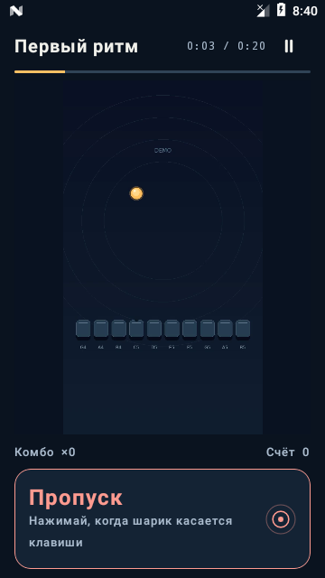

# В такт

Музыкальная игра для iPhone и Android. Смотри на шарик и нажимай на площадку в момент его касания с клавишей. Каждое попадание сразу озвучивает одну ноту мелодии «Первый ритм». Демо длится 20 секунд, в нём 40 нот при темпе 120 BPM. После установки игра работает офлайн.

<p>
  
  
</p>

## Первый запуск на Mac

1. Понадобятся полный **Xcode 26.0.x**, компонент iOS Simulator и **JDK 17**. Эталонная конфигурация проекта — Xcode 26.0.1 и macOS 15.6 или новее с поддержкой этой версии Xcode. Установи JDK, например Temurin 17 для архитектуры своего Mac. Открой Xcode хотя бы один раз, прими лицензию и заверши установку компонентов. Kotlin, Gradle и зависимости скачиваются при первой сборке.
2. Распакуй архив, в терминале перейди в папку `pinch-music`, где лежит `gradlew`. Если в системе несколько Xcode, выбери нужный в **Xcode → Settings → Locations → Command Line Tools**. Проверь окружение и открой проект.

   ```bash
   xcodebuild -version
   /usr/libexec/java_home -F -v 17
   chmod +x gradlew
   open iosApp/iosApp.xcodeproj
   ```

3. Выбери схему **iosApp** и установленный **симулятор iPhone** в верхней панели Xcode. Нажми **⌘R**. Первый запуск собирает `ComposeApp.framework` через Gradle, затем запускает игру в симуляторе. Apple ID и подпись для этого шага не нужны.
4. На настоящем iPhone добавь Apple ID в Xcode, подключи телефон, подтверди доверие, при необходимости включи Developer Mode. У цели **iosApp → Signing & Capabilities** выбери **Team**, включи автоматическую подпись и укажи свой уникальный Bundle Identifier, если текущий занят. Выбери iPhone вместо симулятора и нажми **⌘R**. Ритм и задержку звука лучше оценивать на самом телефоне.

Команда для проверки сборки без открытия Xcode на Apple Silicon:

```bash
xcodebuild -project iosApp/iosApp.xcodeproj -scheme iosApp \
  -configuration Debug -destination 'generic/platform=iOS Simulator' \
  ARCHS=arm64 ONLY_ACTIVE_ARCH=YES CODE_SIGNING_ALLOWED=NO build
```

Для поддерживаемого Intel Mac используй `ARCHS=x86_64`. Если Xcode пишет, что Java не найдена, проверь именно `/usr/libexec/java_home -F -v 17` — эта команда должна найти установленный JDK 17. При использовании Homebrew установить его можно через `brew install --cask temurin@17`. Сборка использует JDK 17, даже если в системе по умолчанию выбрана Java 25. Если список симуляторов пуст, установи iOS Simulator в настройках компонентов Xcode. Устанавливать CocoaPods или генерировать проект перед запуском не требуется.

## Android с Mac или Linux

Установи JDK 17, Android SDK Platform 36, Build-Tools 35.0.0 и Platform-Tools. В Android Studio можно открыть корневую папку, выбрать конфигурацию приложения модуля `composeApp`, затем реальное устройство или эмулятор API 24+. В терминале на Mac со стандартным расположением Android SDK выполни команды ниже.

```bash
export JAVA_HOME="$(/usr/libexec/java_home -F -v 17)"
export ANDROID_HOME="$HOME/Library/Android/sdk"
./gradlew :composeApp:testDebugUnitTest :composeApp:assembleDebug
./gradlew :composeApp:installDebug
```

Для `installDebug` заранее запусти эмулятор или подключи телефон с включённой USB-отладкой. APK появляется в `composeApp/build/outputs/apk/debug/`.

## Что проверить за минуту

- **Послушать** проигрывает эталон. Войди в **Играть** и один раз пропусти все удары. Видео должно дойти до конца в тишине, а в результате появиться 40 пропусков и 0 очков.
- Запусти повтор. Первый удар на 2-й секунде — до, второй через 250 мс — ми. Пропусти первый и нажми на второй. Должна прозвучать ми. Удержание пальца даёт один тап.
- Посреди следующей попытки сверни приложение и вернись. Продолжи вручную. Проверь, что отсчёт проходит на замороженном кадре и счёт сохранился. Сравни ощущение звука в динамике и своих наушниках.

## Как устроена игра

| Часть | Место в проекте |
| --- | --- |
| Оценка тапа, промахи, комбо и очки | `composeApp/src/commonMain/kotlin/music/pinch/core` |
| Экранное состояние, переходы и часы плеера | `Session.kt`, `SessionScreen.kt`, `Platform.kt` в `commonMain/kotlin/music/pinch` |
| Меню, игровой экран и результаты | `composeApp/src/commonMain/kotlin/music/pinch/ui` |
| Media3 и SoundPool | `composeApp/src/androidMain` |
| iOS-обвязка, AVPlayer и предзагруженные голоса | `composeApp/src/iosMain`, `iosApp/iosApp` |
| Файлы песни | `media/demo-chart.json`, два MP4 и 10 WAV в `media/samples/` |
| Общие тесты, проверки по сценариям | `composeApp/src/commonTest`, `composeApp/src/androidUnitTest` |

Позиция видеоплеера задаёт время оценки. Окна «Идеально», «Хорошо» и «Попал» включают границы ±45, ±90 и ±120 мс. Лишний тап обнуляет серию и увеличивает знаменатель точности. Итоговые очки равны округлённым `100000 × (Perfect + 0.7 × Good + 0.4 × Okay) / (40 + лишние тапы)`. Рекорд хранится на устройстве.

Синтетическое демо поставлено вместе с ТЗ. Графика нарисована кодом, PCM-сэмплы синтезированы для проекта. Для регенерации установи NumPy, Pillow и FFmpeg с libx264, затем выполни `python3 tools/generate_demo_assets.py`. Игра использует готовые файлы, поэтому для обычной сборки эти инструменты не требуются.

[Результаты проверок и чек-лист устройств](docs/ACCEPTANCE.md) · [Публикация на GitHub](docs/GITHUB.md) · [Таблица совместимости Kotlin](https://kotlinlang.org/docs/multiplatform/multiplatform-compatibility-guide.html)
