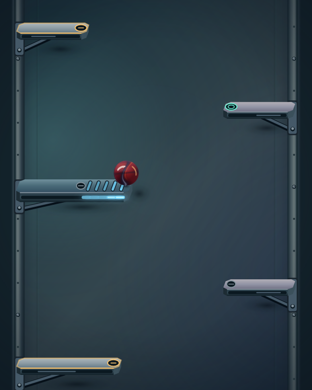
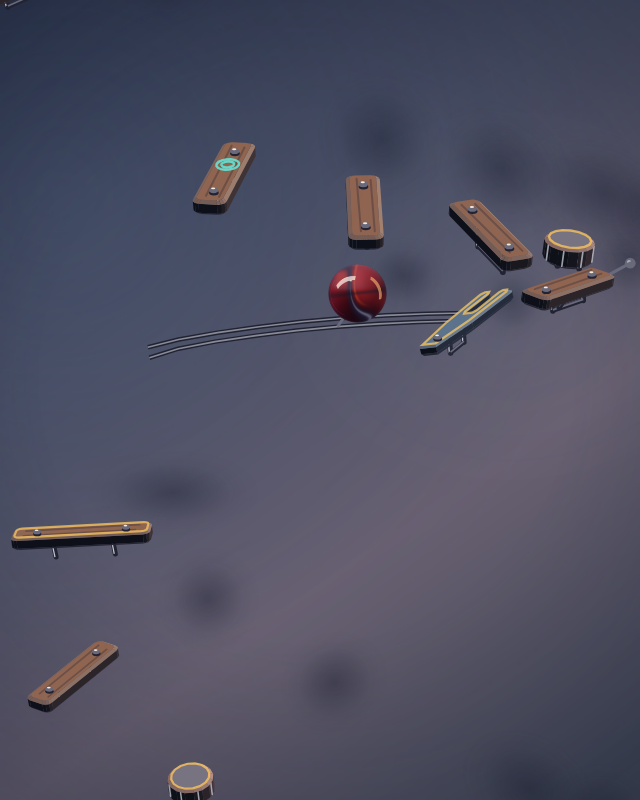

# В такт

Офлайн-ритм-игра для iPhone и Android. Шарик касается панели в момент, когда звучит нота. Касайся любой точки экрана на золотых акцентах, чтобы набрать очки. В главном меню можно выбрать одну из двух трёхмерных сцен и сыграть ту же партию с другого ракурса.

| Каскад X/Y | Орбита |
| --- | --- |
|  |  |
| Вид спереди. Полки выступают из левой и правой стенок. Шарик движется только влево, вправо, вверх и вниз. На длинных полках он последовательно включает свет и звук под собой. | Дорожка огибает сцену по глубине. Деревянные планки отмечают дробные ноты, барабаны — удары в долю, камертоны — протяжённые звуки. |

### Как попробовать каскад

1. Выбери вкладку **Каскад X/Y** и песню **Stereo Love**. Нажми **Послушать**. Первый длинный прокат слышен около **0:07**, быстрые отскоки под аккордеон начинаются на **0:34**. За всю песню шарик проходит 45 LED-полок и включает 123 световые секции.
2. Нажми **Играть** и отбивай золотые акценты. Во время длинного проката попробуй коснуться экрана в момент вспышки LED-секции, чтобы усилить её звук. Можно пропустить все секции и заработать максимум очков на золотых акцентах.
3. Для сравнения вернись в меню и выбери **Орбита**. Песня, темп и правила подсчёта очков в двух вкладках общие.

<details>
<summary>Выбор сцены в приложении</summary>
<p></p>
</details>

**Stereo Love · 127 BPM · 3:04.** В инструментальной аранжировке 508 мелодических нот. На каждую приходится контакт шарика с планкой. В режиме «Послушать» можно проследить весь рисунок аккордеона. В режиме «Играть» 159 акцентов с золотой кромкой приносят очки. Остальные ноты можно отбивать в такт без штрафа. Мелодия продолжается и при пропусках. Точное нажатие добавляет короткий звук удара.

На 40 обычных панелях Stereo Love есть бирюзовые метки эха. Коснись экрана на таком ударе, чтобы услышать ответ в октаву. Эхо указано отдельно в результате. Для золотых акцентов окно попадания достигает ±195 мс, для оценки «Идеально» — ±80 мс.

## Первый запуск на Mac

1. Понадобятся полный **Xcode 26.0.x**, компонент iOS Simulator и **JDK 17**. Эталонная конфигурация проекта — Xcode 26.0.1 и macOS 15.6 или новее с поддержкой этой версии Xcode. Установи JDK, например Temurin 17 для архитектуры своего Mac. Открой Xcode хотя бы один раз, прими лицензию и заверши установку компонентов. Kotlin, Gradle и зависимости скачиваются при первой сборке.
2. Клонируй репозиторий и перейди в корень `pinch-music`, где лежит `gradlew`. Если в системе несколько Xcode, выбери нужный в **Xcode → Settings → Locations → Command Line Tools**. Проверь окружение и открой проект.

   ```bash
   xcodebuild -version
   /usr/libexec/java_home -F -v 17
   chmod +x gradlew
   open iosApp/iosApp.xcodeproj
   ```

3. Выбери схему **iosApp** и установленный **симулятор iPhone** в верхней панели Xcode. Нажми **⌘R**. Первый запуск собирает `ComposeApp.framework` через Gradle, затем запускает игру в симуляторе. Apple ID и подпись для этого шага не нужны.
4. На настоящем iPhone добавь Apple ID в Xcode, подключи телефон, подтверди доверие, при необходимости включи Developer Mode. У цели **iosApp → Signing & Capabilities** выбери **Team**, включи автоматическую подпись и укажи свой уникальный Bundle Identifier, если текущий занят. Выбери iPhone вместо симулятора и нажми **⌘R**. Ритм и задержку звука лучше оценивать на самом телефоне.

Команда для проверки сборки без открытия Xcode на Apple Silicon:

```bash
xcodebuild -project iosApp/iosApp.xcodeproj -scheme iosApp \
  -configuration Debug -destination 'generic/platform=iOS Simulator' \
  ARCHS=arm64 ONLY_ACTIVE_ARCH=YES CODE_SIGNING_ALLOWED=NO build
```

Для поддерживаемого Intel Mac используй `ARCHS=x86_64`. Если Xcode пишет, что Java не найдена, проверь именно `/usr/libexec/java_home -F -v 17` — эта команда должна найти установленный JDK 17. При использовании Homebrew установить его можно через `brew install --cask temurin@17`. Сборка использует JDK 17, даже если в системе по умолчанию выбрана Java 25. Если список симуляторов пуст, установи iOS Simulator в настройках компонентов Xcode. Устанавливать CocoaPods или генерировать проект перед запуском не требуется.

## Android с Mac или Linux

Установи JDK 17, Android SDK Platform 36, Build-Tools 35.0.0 и Platform-Tools. В Android Studio можно открыть корневую папку, выбрать конфигурацию приложения модуля `composeApp`, затем реальное устройство или эмулятор API 24+. В терминале на Mac со стандартным расположением Android SDK выполни команды ниже.

```bash
export JAVA_HOME="$(/usr/libexec/java_home -F -v 17)"
export ANDROID_HOME="$HOME/Library/Android/sdk"
./gradlew :composeApp:testDebugUnitTest :composeApp:assembleDebug
./gradlew :composeApp:installDebug
```

Для `installDebug` заранее запусти эмулятор или подключи телефон с включённой USB-отладкой. APK появляется в `composeApp/build/outputs/apk/debug/`.

## Каталог и собственная запись

В каталог входят On the Floor, Stereo Love, Gypsy Woman, Levels, Stay (The Kid LAROI & Justin Bieber), Turn Down for What, Yeah! и The Final Countdown. У Stereo Love есть полная инструментальная аранжировка, остальные семь карточек содержат короткие игровые фразы. У Gypsy Woman акцент на органной гармонии. Исходные коммерческие записи для игры не требуются.

Чтобы получить фразу из своей записи, выбери песню и нажми **«Выбрать свою запись»**. Выбери аудиофайл из системного диалога. Приложение локально декодирует до 30 секунд аудио, ищет устойчивые высоты ведущего голоса и атаки, убирает близкие удары и сохраняет ноты для этой карточки. На длинной записи участок выбирается автоматически. Короткий файл с нужным припевом даёт контроль над фрагментом. Чистая вокальная или инструментальная дорожка даст более точный результат, чем насыщенный микс. Через **«Вернуть встроенную»** можно восстановить авторскую игровую фразу.

Приложение сохраняет на устройстве выбранную сцену, мелодию и инструмент. У встроенной и импортированной партий отдельные рекорды. Встроенное сопровождение Stereo Love звучит только в её собственной аранжировке.

## Организация проекта

| Код | Назначение |
| --- | --- |
| `composeApp/src/commonMain/kotlin/music/pinch/ui/MarblePath.kt`, `MarbleStage.kt` | Траектория и геометрия в трёх координатах, перспективная камера, проекция, освещение и тени. Начало ноты задаёт точный момент касания. |
| `PlanarPath.kt`, `PlanarStage.kt` в том же каталоге | Боковые полки каскада, движение шарика в плоскости X/Y и синхронизация световых секций с ударами. |
| `StereoLove.kt` и `media/backing/stereo-love.m4a` | Партия игрока и записанное для игры сопровождение Stereo Love. |
| `SongLibrary.kt`, `SongCharts.kt`, `LeadExtraction.kt` в общем модуле | Каталог с фиксированным темпом, локальный анализ звука и сохранение аранжировок. |
| `Session.kt`, `SessionClock.kt`, `core/RhythmGame.kt` | Одна монотонная шкала времени для движения, ввода и проигрывания нот. Результат и серия обновляются по первому касанию. |
| `androidMain`, `iosMain`, `iosApp/iosApp` | Звуковые голоса, файловый диалог, декодеры, настройки и реакции на уход в фон. |
| `media/instruments`, `tools/generate_instruments.py` | Синтезированные WAV для трёх инструментов, покрытие MIDI-высот через транспонирование. |
| `commonTest`, `androidUnitTest` | Тесты окон, перезапуска, темпа песен, выделения нот и совпадения контактов с таймлайном. |

[Музыкальные партии](docs/SONGS.md) · [Проверки и ограничения](docs/ACCEPTANCE.md) · [GitHub Actions и ветки](docs/GITHUB.md)
